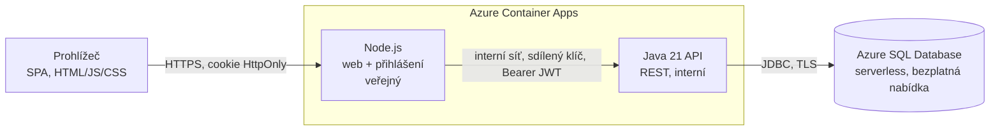

# Nutriční plánovač

Webová aplikace pro nutričního terapeuta: klienti, měření, jídelníčky, recepty, potraviny, PDF dokumenty pro klienta.
Třívrstvá architektura připravená k nasazení do Microsoft Azure s ohledem na nízké náklady.



| Vrstva | Technologie | Složka | Úkol |
|---|---|---|---|
| Frontend | HTML + JavaScript (bez frameworku) | `frontend/` | uživatelské rozhraní; sestavuje se do `web/public` |
| Back end – web | Node.js 22, bez npm balíčků | `web/` | statické soubory, přihlášení (cookie), bezpečnostní hlavičky, limity, předání požadavků na API |
| Back end – API | Java 21, bez knihoven (`com.sun.net.httpserver`) | `api/` | uživatelé a hesla, tokeny, ukládání dokumentů, administrace |
| Databáze | Azure SQL Database (serverless), alternativně PostgreSQL | – | tabulky `users`, `docs`, `audit` |
| Infrastruktura | Bicep, Docker | `infra/`, `*/Dockerfile` | Azure Container Apps, registr obrazů, databáze, logy |

Obě aplikační vrstvy záměrně nemají žádné závislosti (jen JDBC ovladač za běhu). Znamená to méně aktualizací a méně rizik z cizího kódu.

## Rychlý start (lokálně)

Bez Dockeru, data jen v paměti (po zastavení zmizí). Potřebujete JDK 21 a Node.js 20+:

```bash
./run-local.sh            # pak http://localhost:8080 , přihlášení: admin / admin-heslo-12345
```

S Dockerem a skutečnou databází (PostgreSQL):

```bash
docker compose up --build
```

## Testy

```bash
./test-all.sh             # vše; E2E=0 ./test-all.sh přeskočí testy v prohlížeči
```

| Co | Počet | Jak |
|---|---|---|
| Java API (jednotkové + HTTP integrační) | 35 | `api/build.sh test` |
| Frontend – výpočty a logika | 92 | `node frontend/test/core.test.js` |
| Web (Node.js) proti skutečnému Java API | 19 | `cd web && npm test` |
| Prohlížeč – samostatná verze | 8 sad (`e2e1–8`) | `node frontend/test/e2eN.js` |
| Prohlížeč – celý zásobník (přihlášení, data, uživatelé, vypršení relace, zámek) | 39 kontrol | `node e2e/fullstack.js` |
| SQL vrstva proti skutečné databázi | – | ruční: `api/src/test/java/cz/planovac/api/SqlSelfTest.java` |

**Co nebylo možné v místě vzniku ověřit:** běh proti Azure SQL Database (T-SQL), Docker sestavení, Maven (`pom.xml`) a Bicep.
SQL příkazy pro PostgreSQL byly spuštěny na skutečném PostgreSQL 16 (příkazem `psql`); T-SQL byl pouze zkontrolován čtením.
Před ostrým provozem proto spusťte `SqlSelfTest` proti testovací databázi a šablonu Bicep prohlédněte příkazem `what-if` (viz `docs/NASAZENI-AZURE.md`).

## Dokumentace

- [`docs/NASAZENI-AZURE.md`](docs/NASAZENI-AZURE.md) – nasazení krok za krokem, správa, náklady, řešení potíží
- [`docs/ZABEZPECENI.md`](docs/ZABEZPECENI.md) – bezpečnostní model, co je a co není pokryto, GDPR

## Konfigurace (proměnné prostředí)

**Java API**

| Proměnná | Výchozí | Význam |
|---|---|---|
| `APP_ENV` | `development` | `production` zapne povinná tajemství a přísnější kontroly |
| `PORT` | `8081` | port API |
| `STORAGE` | `memory` (v produkci `sql`) | `memory` = jen paměť (vývoj), `sql` = databáze |
| `DB_URL`, `DB_USER`, `DB_PASSWORD` | – | JDBC adresa (`jdbc:sqlserver:` nebo `jdbc:postgresql:`) a přihlášení |
| `DB_POOL_MAX` | `5` | velikost fronty spojení |
| `DB_CONNECT_TIMEOUT_SEC` | `90` | jak dlouho čekat na probuzení databáze |
| `JWT_SECRET` | – (v produkci povinné, ≥ 32 B) | podpis přihlašovacích tokenů |
| `JWT_TTL_MIN` | `480` | platnost přihlášení v minutách |
| `INTERNAL_API_KEY` | – (v produkci povinné, ≥ 24 znaků) | sdílený klíč web ↔ API |
| `PBKDF2_ITERATIONS` | `600000` | náročnost hashování hesel (v produkci ≥ 310000) |
| `MAX_FAILED_LOGINS`, `LOCK_MINUTES` | `5`, `15` | zámek účtu |
| `MAX_DOC_BYTES` | `1048576` | největší dokument |
| `BOOTSTRAP_ADMIN_USER`, `BOOTSTRAP_ADMIN_PASSWORD` | – | první správce; vytvoří se jen pokud nejsou žádní uživatelé |

**Node.js web**

| Proměnná | Výchozí | Význam |
|---|---|---|
| `APP_ENV` | `development` | v produkci se vynutí tajemství, Secure cookie, HSTS |
| `PORT` | `8080` | port webu |
| `API_URL` | `http://127.0.0.1:8081` | adresa Java API |
| `INTERNAL_API_KEY` | – | musí být shodný s API |
| `COOKIE_SECURE`, `HSTS`, `TRUST_PROXY` | v produkci `true` | za proxy (Azure) ponechte zapnuté; lokálně přes http `COOKIE_SECURE=false` |
| `UPSTREAM_TIMEOUT_MS` | `110000` | časový limit volání API (probouzení databáze) |
| `LOGIN_RATE_LIMIT`, `LOGIN_RATE_WINDOW_SEC` | `20`, `900` | pokusů o přihlášení na IP |
| `API_RATE_LIMIT` | `600` | požadavků za minutu na IP |
| `PUBLIC_ORIGIN` | – | přesná povolená Origin (vlastní doména) |
| `STATIC_DIR` | `web/public` | složka se sestaveným frontendem |

## Rozhraní API (shrnutí)

Prohlížeč volá stejné adresy přes webovou vrstvu; ta přidá token z cookie. Všechny změny stavu vyžadují hlavičku `X-NT-CSRF: 1`.

| Metoda a cesta | Popis |
|---|---|
| `GET /api/health` (web i API), `GET /api/ready` (jen API) | stav procesu / připravenost databáze; bez přihlášení, do databáze nesahají |
| `POST /api/auth/login` | `{username,password}` → 200 (nastaví cookie), 401, 429 (+`Retry-After`), 503 |
| `GET /api/auth/me`, `POST /api/auth/password`, `POST /api/auth/logout`, `POST /api/auth/logout-all` | účet |
| `GET /api/docs` | všechna data přihlášeného uživatele |
| `PUT/DELETE /api/docs/{kolekce}/{id}` | uložení / smazání dokumentu (kolekce: clients, tracks, plans, foods, recipes, templates, settings) |
| `GET/POST /api/admin/users`, `POST /api/admin/users/{id}/disable\|enable\|password` | správa uživatelů (jen správce) |

## Omezení

- Funkce využívající AI (návrhy jídel, odhad živin) nejsou v serverové verzi dostupné, protože v ní není k dispozici model. Tlačítka se skrývají. Lze doplnit endpoint na Azure OpenAI.
- Export do PDF a import XLSX načítají knihovny z cdnjs (povoleny jsou v CSP jen dvě konkrétní verze). Po nasazení je třeba obě funkce vyzkoušet.
- Přihlášení je jméno a heslo bez dvoufaktorového ověření; zapomenuté heslo resetuje správce.
